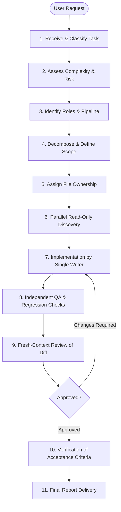

# Aether Agent Orchestration Architecture

**Version:** 1.1.0  
**Status:** Canonical Architecture Specification  
**Governing Standard:** Aether Engineering Constitution & Task Router  

---

## 1. Architectural Overview

The Aether Engineering System (AES) orchestrates specialized AI agents to solve software engineering tasks with high reliability, minimal scope creep, and verifiable correctness.

Rather than relying on monolithic, single-prompt LLM execution, AES enforces:
- **Role Specialization:** Nine dedicated agent roles with bounded capabilities.
- **Least-Privilege Tooling:** Read-only inspection tools for analysts; write tools strictly isolated to implementation roles.
- **Single-Writer Discipline:** Exactly one agent holds edit privileges on any given file set to prevent merge conflicts and race conditions.
- **Fresh-Context Review:** Independent auditing of raw diffs by non-author agents.
- **Honest Runtime Transparency:** Clear disclosure of native parallel delegation vs sequential role execution.



---

## 2. The 13-Stage Orchestration Lifecycle

Every non-trivial engineering task executes through the formal 13-stage lifecycle:

### Stage 1: Receive Task
- Capture user intent, requirements, constraints, and target repositories.
- Sanitize inputs to prevent prompt injection or credential leakage.

### Stage 2: Classify Task
- Classify task shape into one of the standard archetypes (New Project, Feature, Bugfix, Security, Performance, Refactoring, Release).

### Stage 3: Determine Risk & Complexity
- Categorize complexity:
  - **Trivial:** Direct single-step implementation. Skip multi-agent ceremony.
  - **Standard:** Standard linear pipeline (Planner -> Developer -> QA -> Reviewer).
  - **Complex:** Full architectural and security audit with parallel discovery.
- Determine risk profile: production blast radius, data migration, security implications.

### Stage 4: Identify Required Expertise
- Map the task to required subagent roles using the [Task Router](../../core/task-router.md).
- Do not invoke superfluous agents for trivial tasks (Simplicity First).

### Stage 5: Decompose the Task
- `project-planner` decomposes the goal into bounded, ordered, testable task envelopes.
- Define binary acceptance criteria for each phase.

### Stage 6: Assign Responsibilities
- Assign explicit roles to each task envelope.
- Establish prerequisites and dependencies.

### Stage 7: Define File Ownership (Single-Writer Principle)
- Assign explicit file boundaries for each writer.
- **Strict Invariant:** At most one agent (`senior-developer`) is granted write access to target files at any given time.
- All other concurrent subagents execute in read-only mode (`view_file`, `grep_search`, `list_dir`).

### Stage 8: Execute Independent Work
- Run read-only research, architecture mapping, and security auditing in parallel.
- Execute implementation sequentially within the assigned file boundary.

### Stage 9: Collect Results
- Orchestrator gathers evidence, reproduction logs, and implementation diffs from participating roles.

### Stage 10: Perform Integration
- Ensure all created/modified files integrate cohesively with the existing codebase.
- Execute project build/compile commands to verify syntactic and structural validity.

### Stage 11: Run Independent Review
- `independent-reviewer` inspects the raw `git diff` in a fresh context.
- Audit for logic correctness, security risks, regression potentials, simplicity, and scope creep.
- Blocking findings must be returned to the developer for resolution.

### Stage 12: Verify Acceptance Criteria
- `qa-engineer` executes automated tests and checks against the original acceptance criteria.
- Capture exact commands, exit codes, and durations. No test results may be fabricated.

### Stage 13: Produce Final Report
- Deliver the honest completion report documenting:
  - Changes made (files and lines)
  - Exact tests executed and results observed
  - Blockers and unverified areas
  - Known limitations and residual risks

---

## 3. Host Capabilities & Execution Modes

AES detects host runtime capabilities and operates in one of two modes:

### Mode A: Host-Native Parallel Delegation (Ideal)
- Triggered when the runtime supports `invoke_subagent` with true concurrent execution.
- Read-only analysis agents (`principal-architect`, `security-engineer`, `qa-engineer`) execute concurrently in isolated workspaces.
- Findings are aggregated and delivered to `senior-developer`.

### Mode B: Transparent Sequential Fallback (Guaranteed Portable)
- Triggered when `invoke_subagent` is unavailable, quota-limited, or single-threaded.
- The orchestrator executes the defined role stages sequentially.
- **Mandatory Transparency:** The final report must explicitly disclose:
  > *"Host runtime did not support native subagent concurrency. Orchestration executed role stages sequentially under the Aether role contracts."*
- **Never simulate or falsify a subagent invocation.**

---

## 4. Agent Role Directory & Tool Allowlist

| Agent Role | Model | Execution Policy | Write Tools? | Primary Responsibilities |
|---|---|---|---|---|
| `principal-architect` | inherit | sandbox | ❌ No | System boundaries, data flows, integration contracts, tradeoffs. |
| `project-planner` | inherit | sandbox | ❌ No | Scope, ordered task envelopes, acceptance criteria, dependencies. |
| `senior-developer` | inherit | sandbox | ✅ **YES** | Surgical implementation, regression tests, diff self-audit. |
| `debugging-engineer` | inherit | sandbox | ❌ No | Reproduce bugs, trace execution, test hypotheses, isolate root cause. |
| `security-engineer` | inherit | sandbox | ❌ No | Threat model, injection audit, secret scanning, agent safety. |
| `qa-engineer` | inherit | sandbox | ❌ No | Test strategies, boundary matrices, automated execution, regression checks. |
| `independent-reviewer`| inherit | sandbox | ❌ No | Fresh-context diff review, correctness, simplicity, approval verdict. |
| `performance-engineer`| inherit | sandbox | ❌ No | Latency/memory profiling, bottleneck analysis, comparative benchmarks. |
| `devops-engineer` | inherit | sandbox | ❌ No | CI/CD pipelines, container packaging, observability, rollback plans. |

---

## 5. File Ownership & Conflict Prevention Protocol

1. **Static Write Exclusivity:**
   Only `senior-developer` possesses `replace_file_content` and `write_to_file`. All eight other roles are mechanically prevented from mutating repository files.

2. **Scoped Task Envelopes:**
   Every task delegated to `senior-developer` must explicitly declare:
   ```yaml
   target_files:
     - src/auth/token_validator.py
     - tests/auth/test_token_validator.py
   read_only_references:
     - src/auth/models.py
   prohibited_paths:
     - config/production.yaml
   ```

3. **Diff Scope Enforcement:**
   Prior to approval, `independent-reviewer` verifies that `git diff --name-only` contains ONLY files listed in the task's `target_files`. Any unexpected file modifications constitute immediate grounds for rejection (`CHANGES_REQUIRED`).

