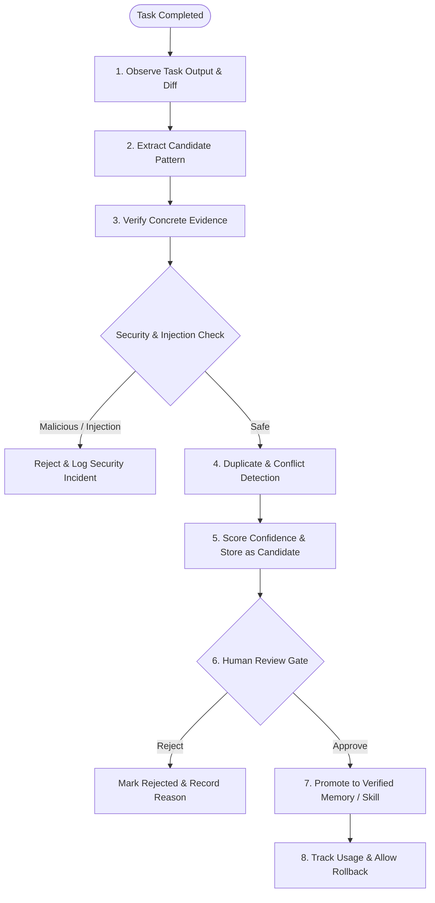

# Aether Continuous Learning Architecture

**Version:** 1.1.0  
**Status:** Canonical Architecture Specification  
**Design Reference:** Controlled, Human-Gated Engineering Evolution  

---

## 1. Architectural Philosophy

AI engineering systems that learn autonomously without human gates rapidly accumulate toxic patterns, prompt injection payloads, brittle project conventions, and hallucinations.

The Aether Engineering System (AES) enforces a **strictly supervised, human-in-the-loop continuous learning model**:
- **Zero Silent Rule Mutations:** The Aether Constitution and global rules can NEVER be modified automatically by an AI agent.
- **Evidence-Backed Lessons:** Every candidate lesson must cite concrete file paths, symbols, commit hashes, or test results.
- **Adversarial Filtering:** Candidate patterns are audited for prompt injection and malicious instructions before being accepted as candidates.
- **Bi-directional Lifecycle:** Every learned pattern can be reviewed, promoted, rejected, or rolled back.

---

## 2. The 10-Stage Learning Lifecycle

### Stage 1: Observe Completed Work
Following completion of an engineering task, the system analyzes:
- The unified `git diff`
- The reproduction/verification test logs
- The root-cause findings or architectural tradeoffs established

### Stage 2: Extract a Candidate Lesson
Identify patterns meeting one of five standard categories:
1. **Project-specific convention:** (e.g. "API routes must return Envelope[T] response format")
2. **Debugging solution:** (e.g. "Intermittent 502s caused by connection pool exhaustion during migration")
3. **Architecture decision:** (e.g. "Use transactional outbox pattern for event emission")
4. **Testing strategy:** (e.g. "Mock external payment gateway using TestContainer fixture")
5. **Common mistake / anti-pattern:** (e.g. "Do not use datetime.now() without timezone UTC")

### Stage 3: Identify Supporting Evidence
Every candidate lesson must contain:
- Exact file paths and line numbers
- Test outcomes proving the pattern worked
- Clear boundaries where the pattern does and does not apply

### Stage 4: Detect Duplicates & Conflicts
The system compares the candidate against existing memory and rules using token similarity and conflict heuristics. Redundant lessons are linked; contradicting lessons are highlighted for human arbitration.

### Stage 5: Assign Confidence & Security Auditing
- Evaluate confidence (`high`, `medium`, `low`) based on test proof.
- Audit text for prompt injection keywords (`ignore previous instructions`, `system prompt override`). Any suspicious pattern is immediately rejected.

### Stage 6: Store as Candidate (`proposed`)
The candidate is recorded in the project memory store with `trust_status: proposed` and `reviewed: false`. It has zero authority over other agents in this state.

### Stage 7: Request Human Approval
The candidate is surfaced to the engineer in the task summary or CLI:
> *"Candidate lesson extracted: [ShopAPI] Redis key prefixes prevent collision. Approve promotion to project memory? (y/n)"*

### Stage 8: Promote into Appropriate Scope
Upon explicit human approval:
- General engineering principles -> Promoted to `memory/global/` or proposed as a candidate update to an Aether skill.
- Project-specific facts -> Promoted to `memory/projects/<id>/` with `trust_status: trusted`.

### Stage 9: Track Effectiveness
Track which lessons are retrieved during future tasks and whether they contributed to passing checks.

### Stage 10: Allow Rejection & Rollback
Engineers can reject or deprecate any learned entry at any time via CLI (`python scripts/learn.py rollback <id>`), instantly removing it from active agent context.

---

## 3. Threat Model for Continuous Learning

| Threat Vector | Mitigation |
|---|---|
| **Poisoned Repository Instructions:** Malicious repo comments trying to trick the agent into adopting dangerous conventions | All candidate lessons run through regex and AST security sanitizers; human approval is mandatory. |
| **Over-Generalization:** A one-off hack promoted to a global standard | Lessons default to project scope; promotion to global scope requires explicit CLI action. |
| **Silent Constitutional Drift:** Agent modifying its own governance rules | Rules and constitution are read-only to learning scripts; only human git commits can alter them. |
| **Credential Accumulation:** Private tokens stored as "learned facts" | Automated multi-pattern secret redaction is applied to all lesson content and evidence fields. |

