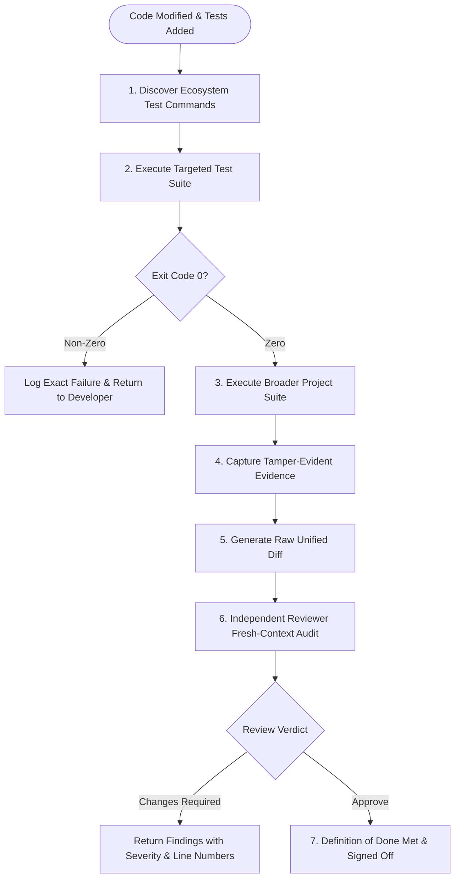

# Aether Engineering Quality Engine

**Version:** 1.1.0  
**Status:** Canonical Architecture Specification  
**Governing Standard:** Aether Constitution, Definition of Done, and Task Router  

---

## 1. Architectural Philosophy

Engineering quality cannot be achieved through code generation alone. Code is an unverified hypothesis until proven correct by deterministic tests, static checks, and fresh-context peer review.

The Aether Quality Engine enforces:
1. **Automatic Ecosystem Discovery:** Introspects project manifests (`package.json`, `pyproject.toml`, `pom.xml`, `Cargo.toml`, `go.mod`, `.csproj`) to discover native test and verification commands without blind code execution.
2. **Tamper-Evident Evidence Capture:** Captures exact command invocations, working directories, exit codes, execution durations, and output streams.
3. **No Fabricated Passes:** A test check is marked `PASSED` if and only if the command terminated with exit code 0 and non-zero tests were executed. Skipped checks are explicitly flagged.
4. **Dual Quality Gates:**
   - **Gate A (Automated Verification):** Test execution, build verification, and regression prevention.
   - **Gate B (Independent Code Review):** Fresh-context analysis of the raw unified diff for correctness, simplicity, security, and contract integrity.

---

## 2. Supported Project Ecosystems

| Ecosystem | Manifest Markers | Discovered Commands |
|---|---|---|
| **Node.js / React / Next.js** | `package.json` | `npm test`, `npm run build`, `npm run lint` (or pnpm/yarn equivalents) |
| **Python** | `pyproject.toml`, `requirements.txt`, `pytest.ini` | `pytest`, `python -m unittest discover` |
| **Java (Maven)** | `pom.xml` | `mvn test`, `mvn verify` |
| **Java / Kotlin (Gradle)** | `build.gradle`, `build.gradle.kts` | `./gradlew test` or `gradle test` |
| **Rust** | `Cargo.toml` | `cargo test`, `cargo check` |
| **Go** | `go.mod` | `go test ./...` |
| **.NET / C#** | `*.csproj`, `*.sln` | `dotnet test`, `dotnet build` |

---

## 3. The 8-Stage Bug-Fixing Workflow

1. **Capture & Reproduce:** Reproduce the reported defect in a minimal, isolated test environment.
2. **Trace & Hypothesize:** Formulate ranked hypotheses and trace the failure path through source code.
3. **Create Regression Test:** Write an automated test case that fails against the current codebase (reproducing the bug).
4. **Implement Minimal Surgical Fix:** Apply the smallest complete code modification required to address the root cause.
5. **Execute Regression Test:** Prove that the new test transitions from RED to GREEN.
6. **Run Existing Test Suite:** Verify that no adjacent workflows or legacy capabilities were broken by the fix.
7. **Audit the Raw Diff:** Verify single-writer discipline, surgical line bounds, and absence of extraneous edits.
8. **Deliver Honest Completion Report:** State exact commands executed, exit codes, and test durations.

---

## 4. The 8-Stage Feature-Development Workflow

1. **Understand Requirements:** Identify business goals, boundary conditions, and non-goals.
2. **Define Acceptance Criteria:** Write explicit, verifiable pass/fail criteria.
3. **Inspect Existing Architecture:** Review call sites, data models, and contracts before editing.
4. **Identify Test Scenarios:** Map out unit, boundary, and negative test cases.
5. **Implement Surgically:** Write the minimum complete code solution adhering to existing patterns.
6. **Run Automated Checks:** Execute newly written tests and relevant project test suites.
7. **Independent Diff Review:** Peer review raw unified diff for correctness, simplicity, and security.
8. **Verify Acceptance Criteria:** Validate all criteria against captured evidence.

---

## 5. Independent Review Protocol & Verdicts

Every non-trivial diff is inspected by `independent-reviewer` using an objective rubric:

| Dimension | Inspection Target |
|---|---|
| **Correctness** | Logic bugs, null safety, boundary off-by-one errors, resource leaks |
| **Security** | Input sanitization, injection, secret exposure, authorization checks |
| **Simplicity** | Minimal code diff, no premature abstractions or speculative complexity |
| **Surgical Scope** | Only approved target files edited; no unrelated refactoring |
| **Test Quality** | Meaningful assertions, edge case coverage, deterministic results |

### Review Verdicts
- **`APPROVE`:** Zero blocking or high-severity issues. All acceptance criteria evidenced.
- **`APPROVE_WITH_NON_BLOCKING_ISSUES`:** Safe to complete; minor recommendations for future consideration.
- **`CHANGES_REQUIRED`:** Blocked. High or medium severity defects must be fixed by `senior-developer` before approval.

